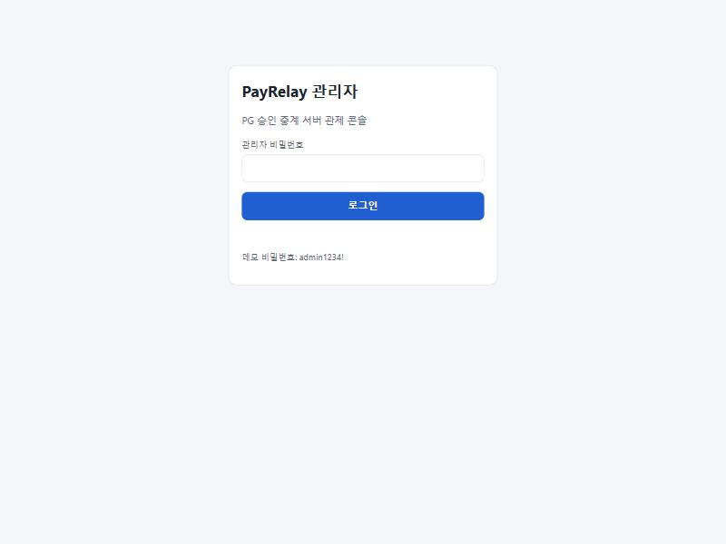
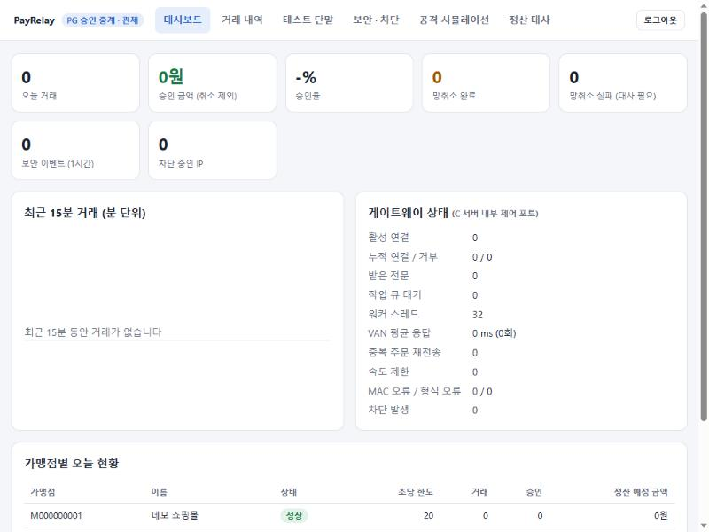
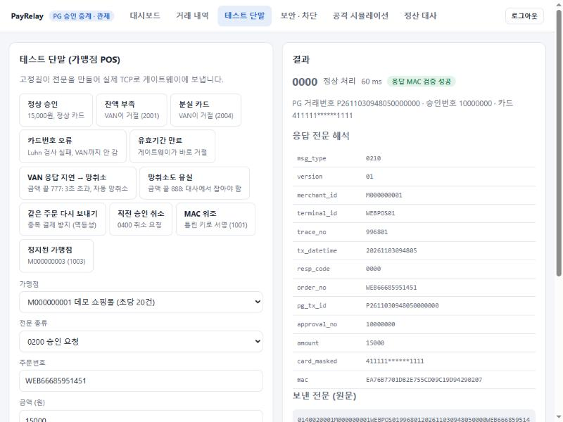
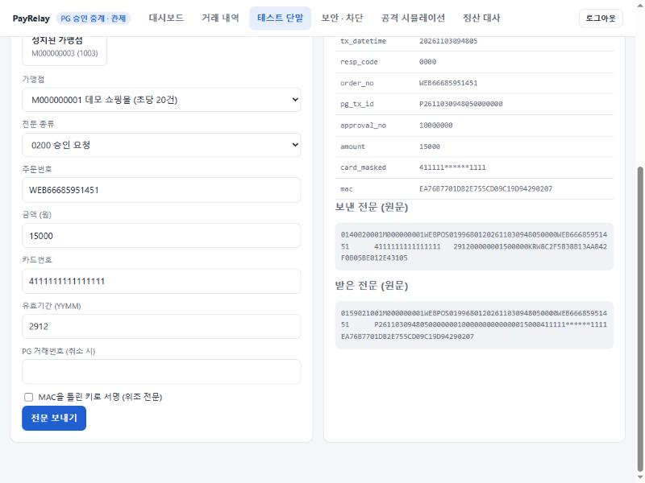
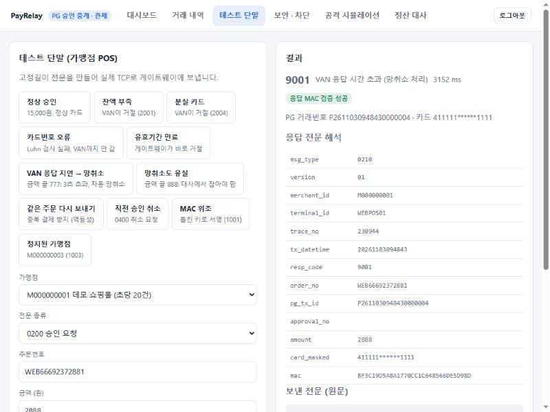
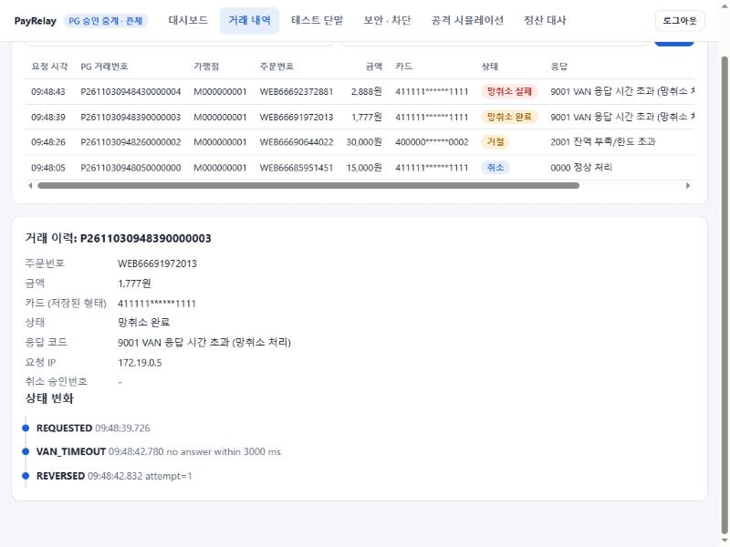
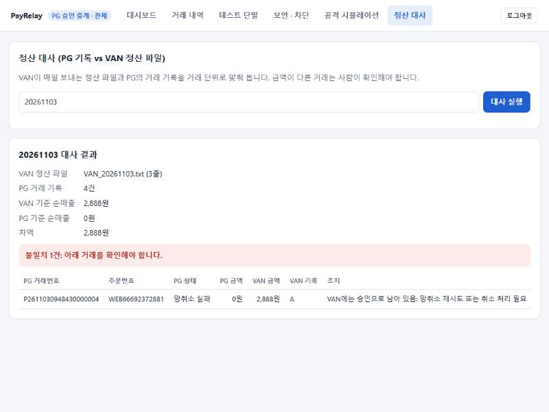
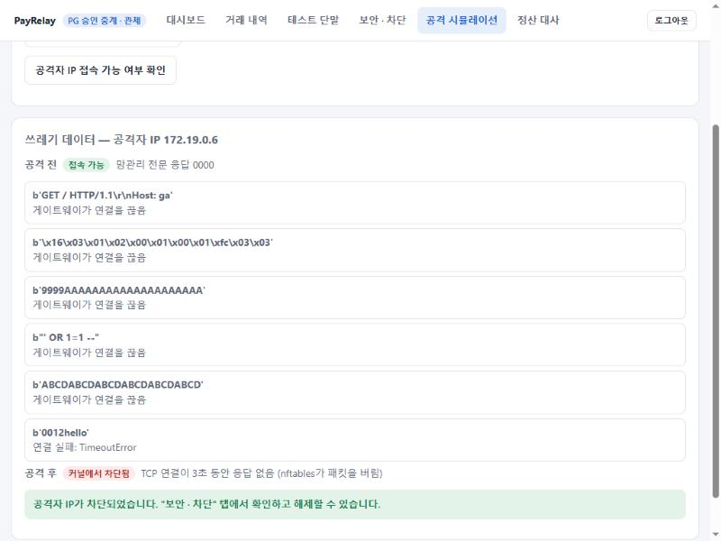
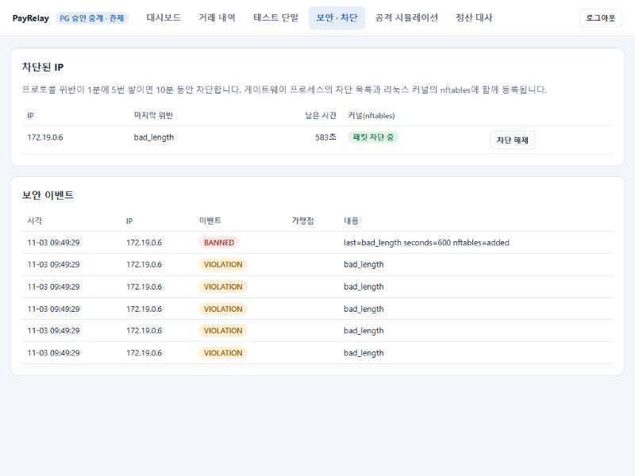
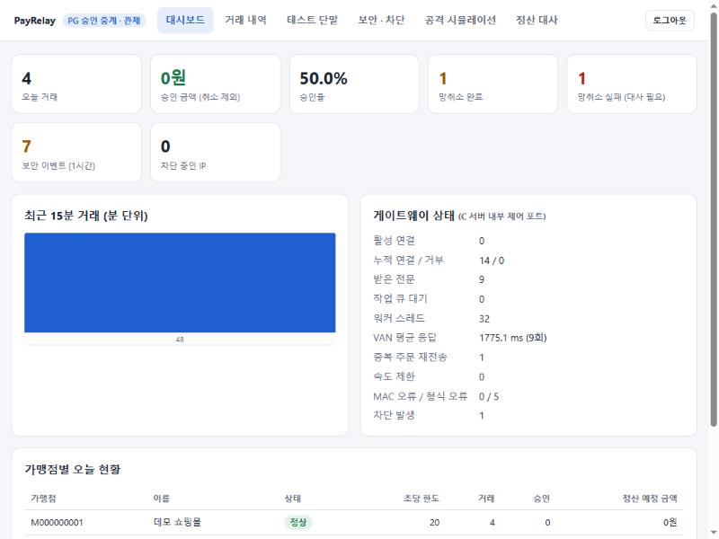

# PayRelay 테스트 가이드 (처음 해보는 분을 위한 안내서)

이 문서는 결제나 네트워크 프로그래밍을 몰라도 PayRelay를 직접 실행하고, 카드 결제가 어떻게 처리되고 어떻게 지켜지는지 하나씩 확인할 수 있도록 만든 안내서입니다.
각 테스트마다 **따라 하기**, **무슨 일이 일어났나요? (원리)**, **왜 필요한가요? (목적)** 를 함께 설명합니다.

> 걸리는 시간: 준비 15~30분(처음 한 번, 대부분 다운로드) + 테스트 30분 정도
> 필요한 것: Windows 10/11 PC, 인터넷. 마지막 자동 테스트만 Python 3이 필요합니다.

---

## 목차

0. [PayRelay가 뭔가요?](#0-payrelay가-뭔가요)
1. [준비하기](#1-준비하기)
2. [테스트 1. 정상 결제 (승인)](#테스트-1-정상-결제)
3. [테스트 2. 같은 주문 다시 보내기 (중복 결제 방지)](#테스트-2-같은-주문-다시-보내기)
4. [테스트 3. 거절되는 결제](#테스트-3-거절되는-결제)
5. [테스트 4. 결제 취소](#테스트-4-결제-취소)
6. [테스트 5. 카드사가 늦게 답할 때 (망취소)](#테스트-5-카드사가-늦게-답할-때)
7. [테스트 6. 정산 대사: 장부 맞춰 보기](#테스트-6-정산-대사)
8. [테스트 7. 위조 전문과 정지된 가맹점](#테스트-7-위조-전문과-정지된-가맹점)
9. [테스트 8. 공격 시뮬레이션과 차단](#테스트-8-공격-시뮬레이션과-차단)
10. [테스트 9. 대시보드 읽기](#테스트-9-대시보드-읽기)
11. [테스트 10. 자동 테스트 한 번에 돌리기](#테스트-10-자동-테스트-한-번에-돌리기)
12. [문제가 생겼을 때](#문제가-생겼을-때)
13. [끝내기와 처음부터 다시 하기](#끝내기와-처음부터-다시-하기)
14. [용어 사전](#용어-사전)

---

## 0. PayRelay가 뭔가요?

카페에서 카드를 내밀면 1~2초 만에 "승인되었습니다"가 나옵니다. 그 사이에 이런 일이 일어납니다.

```
 카드 단말기(가맹점) ──► PG(결제대행사) ──► VAN(카드사 중계망) ──► 카드사
      "15,000원 결제해도 되나요?"                              "잔액 충분, 승인번호 10000000"
                     ◄──────────────────────────────────────────────
```

**PayRelay는 이 중 PG 역할을 하는 서버**입니다. C 언어로 만들었고 리눅스에서 돌아갑니다. 테스트를 위해 카드사 역할을 하는 **VAN 시뮬레이터**, 거래를 저장하는 **MySQL 데이터베이스**, 상황을 보는 **관리 콘솔**, 일부러 공격을 해 보는 **공격자 프로그램**을 함께 띄웁니다.

| 실제 세상 | PayRelay에서는 |
|---|---|
| 가게의 카드 단말기 | 관리 콘솔의 **테스트 단말** 화면 |
| PG 서버 | **pg-gateway** (C 프로그램) |
| 카드사·VAN | **van-sim** (C 프로그램, 정해진 카드번호·금액에 따라 승인/거절) |
| 거래 장부 | **MySQL** 데이터베이스 |
| 카드사가 매일 보내는 정산 내역 | VAN 시뮬레이터가 쓰는 **정산 파일** |
| 관제실 | **관리 콘솔** (http://localhost:8090) |

### "전문"이란?

결제 시스템끼리는 **칸 길이가 정해진 서류 양식**으로 말합니다. 이걸 전문(電文)이라고 합니다. 예를 들어 주문번호는 20칸, 금액은 12칸입니다. 칸이 남으면 숫자는 앞을 0으로, 글자는 뒤를 공백으로 채웁니다.

```
0140 0200 01 M000000001 WEBPOS01 996801 20261103094805 0000 WEB66685951451······ 4111111111111111··· 2912 000000015000 00 KRW 8C2F5B38...
길이  종류 버전 가맹점ID    단말ID   일련번호 거래일시        응답코드 주문번호(20칸)          카드번호(19칸)         유효기간 금액(12칸)    할부 통화 MAC(위조 방지 서명)
```

마지막의 **MAC**은 가맹점만 아는 비밀 키로 만든 서명입니다. 금액을 한 글자라도 바꾸면 MAC이 맞지 않게 되어, 중간에서 누가 "15,000원"을 "1,500,000원"으로 고치는 것을 막습니다.

> 이 프로그램은 내 PC 안에서만 도는 연습 환경입니다. 진짜 카드나 돈은 전혀 쓰이지 않고, 카드번호는 모두 테스트용 번호입니다. 포트는 이 PC(127.0.0.1)에서만 열립니다.

---

## 1. 준비하기

### 1-1. Docker Desktop 설치

**Docker**는 프로그램을 실행 환경째로 상자(컨테이너)에 담아 어느 PC에서나 똑같이 돌리게 해 주는 도구입니다. PayRelay는 리눅스용 C 프로그램, MySQL, Node.js가 필요한데 Docker가 있으면 하나하나 설치할 필요가 없습니다.

1. https://www.docker.com/products/docker-desktop/ 에서 **Download for Windows**를 눌러 설치합니다.
2. "WSL 2 사용" 옵션은 체크된 그대로 둡니다. 설치가 끝나면 PC를 다시 시작합니다.
3. 시작 메뉴에서 **Docker Desktop**을 실행합니다. 로그인은 하지 않아도 됩니다(Skip).
4. 창 왼쪽 아래가 **초록색(Engine running)** 이 되면 준비 완료입니다. 테스트하는 동안 계속 켜 둡니다.

### 1-2. PayRelay 내려받기

https://github.com/LEntropy/Pay_Logic 에서 초록색 **Code** 버튼 → **Download ZIP**을 누르고, 원하는 곳에 압축을 풉니다. (Git이 있다면 `git clone https://github.com/LEntropy/Pay_Logic.git`)

### 1-3. 폴더에서 PowerShell 열기

1. 파일 탐색기에서 압축을 푼 폴더(`Pay_Logic-main`)를 엽니다. `docker-compose.yml` 파일이 보이면 맞는 폴더입니다.
2. 탐색기 위쪽 **주소창**을 클릭해 내용을 지우고 `powershell`을 입력한 뒤 Enter를 누릅니다.
3. `PS C:\...\Pay_Logic-main>`처럼 폴더 경로가 보이는 창이 열리면 성공입니다.

### 1-4. 실행하기

```powershell
docker compose up -d --build
```

- **무슨 일이 일어나나요?** Docker가 MySQL, C 컴파일러, Node.js, Python 이미지를 내려받습니다. 이어서 C 프로그램을 컴파일하고(이때 단위 테스트도 함께 돌립니다), 컨테이너 6개를 실행합니다: mysql, certs(인증서 생성), van, gateway, admin, attacker.
- **처음 한 번은 10~30분** 걸릴 수 있습니다. 두 번째부터는 1분 안에 켜집니다.
- 끝에 `Started`가 줄줄이 나오면 실행된 것입니다. `docker compose ps`를 입력하면 상태를 볼 수 있습니다.

### 1-5. 관리 콘솔 접속

브라우저(Chrome, Edge 등)에서 **http://localhost:8090** 을 엽니다. 비밀번호 `admin1234!`를 입력하고 **로그인**합니다.



처음에는 모든 숫자가 0인 대시보드가 보입니다. 아래 "가맹점별 오늘 현황"에 데모 가맹점 4곳이 보이면 데이터베이스까지 정상입니다.



> 연결할 수 없다는 화면이 나오면 서버가 아직 켜지는 중입니다. 30초 뒤 새로고침(F5)하세요.

---

## 테스트 1. 정상 결제

### 따라 하기

1. 위쪽 메뉴에서 **테스트 단말**을 누릅니다. 왼쪽이 카드 단말기, 오른쪽이 결과 화면입니다.
2. 처음에는 **정상 승인** 시나리오(15,000원, 정상 카드)가 채워져 있습니다. 아래로 내려 **전문 보내기**를 누릅니다.
3. 오른쪽에 **0000 정상 처리**가 나옵니다. PG 거래번호와 승인번호가 발급되고, 카드번호는 `411111******1111`로 가려져 있습니다.

   

4. 결과를 아래로 내리면 **보낸 전문 (원문)**, **받은 전문 (원문)** 이 보입니다. 실제로 서버에 오간 글자 그대로입니다.

   

### 확인할 것

- [ ] 응답 코드 0000, "응답 MAC 검증 성공" 표시
- [ ] 응답의 카드번호가 가운데 6자리가 `*`로 가려져 있음
- [ ] 보낸 전문은 `0140`으로 시작 (길이 140글자가 뒤따른다는 뜻)

### 무슨 일이 일어났나요? (원리)

```
 테스트 단말 ─TCP─► 게이트웨이 ─────────────────────────────────────────► VAN
                    ① 길이(0140)만큼 다 왔나? 칸마다 허용 문자인가?
                    ② 가맹점 M000000001의 비밀 키로 MAC 다시 계산 → 같은가?
                    ③ 이 가맹점이 초당 20건을 넘지 않았나?
                    ④ 카드번호 체크섬(Luhn)·유효기간 확인
                    ⑤ DB에 "처리 중(PENDING)"으로 먼저 기록
                    ⑥ VAN에 암호화 연결(mTLS)로 전달 ────────────────────► "승인 10000000"
                    ⑦ DB를 "승인(APPROVED)"으로 바꾸고 단말에 응답 ◄──────
```

- ⑤에서 **VAN에 묻기 전에 먼저 기록**하는 이유는, 서버가 중간에 죽어도 "물어본 적이 있다"는 사실이 남아야 나중에 정리할 수 있기 때문입니다.
- 게이트웨이와 VAN 사이는 **서로 인증서를 확인하는 TLS(mTLS)** 로 연결됩니다. 양쪽 모두 같은 기관(사설 CA)이 발급한 인증서를 보여 줘야 대화가 시작됩니다.
- 카드번호는 **데이터베이스에 저장되지 않습니다.** 앞 6자리, 뒤 4자리, 그리고 되돌릴 수 없는 토큰(HMAC 값)만 저장합니다.

### 왜 필요한가요? (목적)

결제 정보는 해커가 가장 노리는 데이터입니다. 저장하지 않은 카드번호는 유출될 수도 없습니다. MAC은 통신 중간에 금액이나 가맹점을 바꿔치기하는 것을, 상호 TLS는 가짜 VAN·가짜 PG가 끼어드는 것을 막습니다.

---

## 테스트 2. 같은 주문 다시 보내기

### 따라 하기

1. 시나리오 버튼 중 **같은 주문 다시 보내기**를 누릅니다. 주문번호, 금액, 카드가 방금 승인된 것과 똑같이 채워집니다.
2. **전문 보내기**를 누릅니다.
3. 다시 **0000**이 나오는데, **PG 거래번호와 승인번호가 방금과 똑같습니다.**
4. 메뉴 **거래 내역**을 열어 보면 15,000원 거래는 **1건**뿐입니다.

### 무슨 일이 일어났나요? (원리)

데이터베이스에 "가맹점 + 주문번호" 조합은 하나만 존재할 수 있다는 규칙(UNIQUE 제약)이 있습니다. 같은 주문이 다시 오면 게이트웨이는 새로 결제하지 않고, **저장해 둔 처음 결과를 그대로** 돌려줍니다. 카드사에는 다시 묻지 않습니다. 이것을 **멱등성**(같은 요청을 여러 번 보내도 결과가 한 번 보낸 것과 같은 성질)이라고 합니다.

> 자동 테스트에서는 10개 단말이 같은 주문을 **동시에** 보내도 DB에 1건만 생기는지까지 확인합니다.

### 왜 필요한가요? (목적)

단말기는 응답을 못 받으면 **다시 보냅니다**(네트워크가 잠깐 끊기면 흔한 일). 서버가 이걸 새 결제로 처리하면 손님은 **두 번 결제**됩니다. 결제 시스템에서 가장 피해야 하는 사고 중 하나입니다.

---

## 테스트 3. 거절되는 결제

### 따라 하기

시나리오 버튼을 하나씩 누르고, 누를 때마다 **전문 보내기**를 누릅니다.

| 시나리오 | 결과 | 누가 거절했나 |
|---|---|---|
| **잔액 부족** | 2001 잔액 부족/한도 초과 | VAN(카드사) |
| **분실 카드** | 2004 분실/정지 카드 | VAN(카드사) |
| **카드번호 오류** | 2002 카드번호 오류 | 게이트웨이가 스스로 (VAN에 안 물어봄) |
| **유효기간 만료** | 2003 유효기간 만료 | 게이트웨이가 스스로 |

**거래 내역** 메뉴를 열어 보면 VAN이 거절한 건은 오른쪽 "VAN 응답" 칸에 시간(예: 41 ms)이 있고, 게이트웨이가 거절한 건은 비어 있습니다.

### 무슨 일이 일어났나요? (원리)

- 카드번호의 마지막 숫자는 앞 숫자들로 계산한 **체크섬(Luhn 알고리즘)** 입니다. 한 자리만 잘못 눌러도 계산이 맞지 않습니다. 유효기간도 오늘 날짜와 비교하면 됩니다. 이 두 가지는 카드사에 묻지 않아도 게이트웨이가 바로 알 수 있습니다.
- 잔액이나 분실 여부는 카드사만 압니다. 그래서 VAN까지 다녀와야 합니다.

### 왜 필요한가요? (목적)

명백히 틀린 요청까지 카드사에 보내면 비용(VAN 수수료)과 시간이 낭비되고 카드사에도 부담이 됩니다. 걸러낼 수 있는 것은 앞에서 거르는 것이 좋습니다.

---

## 테스트 4. 결제 취소

### 따라 하기

1. 시나리오 **직전 승인 취소**를 누릅니다. 전문 종류가 **0400 취소 요청**으로 바뀌고, 테스트 1의 주문번호·금액·PG 거래번호가 채워집니다.
2. **전문 보내기** → **0000 정상 처리**.
3. 같은 버튼(**직전 승인 취소**)을 다시 누르고 **전문 보내기** → **3002 이미 취소됨**.
4. **거래 내역**에서 15,000원 거래의 상태가 **취소**로 바뀌었습니다.

### 무슨 일이 일어났나요? (원리)

취소할 때 게이트웨이는 그 거래를 데이터베이스에서 **잠그고(SELECT ... FOR UPDATE)** VAN에 취소를 요청한 뒤 결과를 저장하고 잠금을 풉니다. 그동안 같은 거래에 대한 다른 취소 요청은 기다려야 하므로, 동시에 두 번 취소되는 일이 없습니다. 금액이 원래 결제와 다르면 **3003**, 원래 결제가 없으면 **3001**로 거절합니다.

### 왜 필요한가요? (목적)

취소가 두 번 처리되면 가맹점이 돈을 두 번 돌려주게 됩니다. 반대로 취소가 됐는지 안 됐는지 모르는 상태도 위험합니다. 그래서 "한 번만, 확실하게"를 지키는 장치가 필요합니다.

---

## 테스트 5. 카드사가 늦게 답할 때

### 따라 하기

1. 시나리오 **VAN 응답 지연 → 망취소**(금액 1,777원)를 누르고 **전문 보내기**를 누릅니다.
2. 약 **3초** 뒤 **9001 VAN 응답 시간 초과 (망취소 처리)** 가 나옵니다.

   

3. 10초쯤 기다린 뒤 **거래 내역**을 열고 1,777원 거래를 **클릭**합니다. 아래에 상태 변화가 나옵니다.

   

   - `REQUESTED`: 요청 받음
   - `VAN_TIMEOUT`: 3초 안에 답이 없음
   - `REVERSED`: 망취소 확인됨 → 상태 **망취소 완료**

### 무슨 일이 일어났나요? (원리)

VAN 시뮬레이터는 금액 끝자리가 777이면 일부러 5초 뒤에 답하도록 만들어져 있습니다. 게이트웨이는 3초만 기다립니다.

```
 0초   게이트웨이 → VAN : 승인 요청
 3초   (답이 없음) 게이트웨이 → 단말 : "9001 실패"   ← 단말을 더 기다리게 하지 않음
 3초   게이트웨이 → VAN : 망취소(0420) "방금 그 요청, 혹시 처리했다면 없던 일로"
 3초   VAN : 망취소 기록. 아직 처리 전인 원래 요청은 나중에 와도 장부에 안 올림
 5초   VAN : 늦게 도착한 원래 요청 → 이미 망취소됨, 거절
```

**망취소**는 "결과를 모르는 거래를 확실하게 없던 일로 만드는 요청"입니다. 실패한 결제가 아니라 **결과를 모르는 결제**를 정리하는 장치라는 점이 핵심입니다.

### 왜 필요한가요? (목적)

답이 늦은 것이지 승인이 안 된 것은 아닐 수 있습니다. 가게는 "실패"라고 안내했는데 카드사에서는 돈이 나갔다면, 손님은 물건도 못 받고 돈만 빠져나갑니다. 망취소가 이 상황을 막습니다.

---

## 테스트 6. 정산 대사

### 따라 하기

1. **테스트 단말**에서 시나리오 **망취소도 유실**(금액 2,888원)을 누르고 **전문 보내기**를 누릅니다. 역시 9001이 나옵니다.
2. 15초쯤 기다린 뒤 **거래 내역**을 보면 2,888원 거래가 **망취소 실패**입니다. 게이트웨이가 망취소를 3번 보냈지만 VAN이 한 번도 답하지 않았기 때문입니다(일부러 그렇게 만든 시나리오).
3. 메뉴 **정산 대사**를 열고 **대사 실행**을 누릅니다.

   

4. **불일치 1건**: VAN 정산 파일에는 2,888원이 승인(A)으로 남아 있고, PG 기록에서는 망취소 실패입니다. "조치" 칸에 무엇을 해야 하는지 나옵니다.

### 무슨 일이 일어났나요? (원리)

VAN 시뮬레이터는 실제 VAN처럼 하루 동안 처리한 거래를 **정산 파일**(`VAN_20261103.txt`)에 한 줄씩 남깁니다.

```
A|P2611030948050000000|15000|10000000|20261103094805    ← 승인
C|P2611030948050000000|15000|10000000|20261103094827    ← 취소
A|P2611030948430000004|2888|10000001|20261103094848     ← 승인 (망취소가 유실됨)
```

**대사**는 이 파일과 PG의 데이터베이스를 거래번호마다 맞춰 보는 작업입니다. 15,000원은 승인 후 취소, 1,777원은 망취소가 먼저 도착해 VAN이 아예 장부에 올리지 않았으므로 양쪽이 일치합니다. 2,888원만 VAN은 "승인", PG는 "실패"로 서로 다릅니다.

### 왜 필요한가요? (목적)

아무리 잘 만든 시스템도 네트워크 장애 속에서는 기록이 어긋날 수 있습니다. 실제 PG사는 매일 대사를 해서 어긋난 거래를 찾아 고칩니다. 이게 없으면 돈이 새는 것을 아무도 모릅니다.

---

## 테스트 7. 위조 전문과 정지된 가맹점

### 따라 하기

1. 시나리오 **MAC 위조**를 누릅니다. 아래 "MAC을 틀린 키로 서명 (위조 전문)"이 체크됩니다. **전문 보내기** → **1001 MAC 오류**. 99만원 결제 요청이지만 거래 내역에는 아무것도 남지 않습니다.
2. 시나리오 **정지된 가맹점**을 누르고 **전문 보내기** → **1003 미등록/정지 가맹점**.

### 무슨 일이 일어났나요? (원리)

게이트웨이는 전문의 가맹점 ID로 그 가맹점의 비밀 키를 찾아 MAC을 직접 다시 계산합니다. 키를 모르는 사람이 만든 전문은 MAC이 맞지 않아 결제 처리 단계까지 가지 못합니다. 계약이 정지된 가맹점은 MAC이 맞더라도 거절합니다.

> MAC 위조는 "위반"으로 기록됩니다. 테스트 단말 화면에서 **1분 안에 5번 이상** 보내면, 관리 콘솔 컨테이너 자체가 차단되어 테스트 단말이 더 이상 동작하지 않습니다. 이것도 정상 동작입니다. [문제가 생겼을 때](#문제가-생겼을-때)를 보고 해제하세요.

---

## 테스트 8. 공격 시뮬레이션과 차단

이번에는 **공격자 컨테이너**(다른 IP 주소를 가진 별도 프로그램)가 게이트웨이를 실제로 공격합니다.

### 따라 하기

1. 메뉴 **공격 시뮬레이션** → **쓰레기 데이터**를 누릅니다. 몇 초 뒤 결과가 나옵니다.

   

   - **공격 전: 접속 가능**
   - HTTP 요청, TLS 핸드셰이크, SQL 문자열 등 전문이 아닌 데이터 → **게이트웨이가 연결을 끊음** 5번
   - 6번째: **연결 실패: TimeoutError**. 이제 연결 자체가 안 됩니다.
   - **공격 후: 커널에서 차단됨** (TCP 연결이 3초 동안 응답 없음)

2. 메뉴 **보안 · 차단**을 엽니다. 공격자 IP가 **패킷 차단 중**으로 올라와 있고, 아래에는 위반 5번과 차단 기록이 시간순으로 남아 있습니다.

   

3. **차단 해제**를 누릅니다. 목록이 비워집니다.
4. 다시 **공격 시뮬레이션**에서 **공격자 IP 접속 가능 여부 확인**을 누르면 **접속 가능**으로 돌아왔습니다.

나머지 공격도 같은 방법으로 해 보세요. 한 공격이 끝나면 **보안 · 차단**에서 해제하고 다음 공격을 해야 "공격 전: 접속 가능"부터 볼 수 있습니다.

| 버튼 | 하는 짓 | 게이트웨이의 대응 |
|---|---|---|
| **MAC 위조** | 키를 모르는 공격자가 99만원 승인 요청을 반복 | 1001 응답, 5번째에 차단 |
| **Slowloris** | 전문을 시작만 하고 끝내지 않은 연결 6개로 서버 붙잡기 (약 10초 걸림) | 5초 안에 전문이 완성되지 않으면 끊고 차단 |
| **연결 폭주** | 동시 연결 70개 (허용은 IP당 50개) | 초과분 거부, 차단 |
| **VAN 사칭 접속** | 다른 기관이 발급한 인증서 / 인증서 없이 VAN에 접속 | TLS 단계에서 거부 (게이트웨이 차단과는 별개) |

### 무슨 일이 일어났나요? (원리)

게이트웨이는 IP 주소마다 **위반**(형식 오류, MAC 오류, 느린 전문, 연결 초과)을 셉니다. 1분 안에 5번이 되면 그 IP를 10분 동안 차단하는데, 두 겹으로 막습니다.

1. **게이트웨이 프로그램 안의 차단 목록**: 접속해 오면 바로 끊습니다.
2. **리눅스 커널의 방화벽(nftables)**: 게이트웨이가 그 IP를 방화벽 목록에 직접 추가합니다. 이후 그 IP의 패킷은 프로그램에 도착하기도 전에 운영체제가 버립니다. 그래서 공격자 쪽에서는 "끊겼다"가 아니라 **아무 응답이 없는(시간 초과)** 상태가 됩니다.

정상 가맹점이 순간적으로 요청을 많이 보내는 것(속도 제한 초과)은 위반으로 세지 않습니다. 진짜 손님을 공격자로 오해해 차단하면 안 되기 때문입니다.

### 왜 필요한가요? (목적)

결제 서버는 인터넷에 열려 있어 늘 공격을 받습니다. 이상한 데이터를 하나하나 거절하는 것만으로는 부족합니다. 공격자가 계속 연결을 맺는 것 자체가 서버 자원을 쓰기 때문입니다. 반복 공격자는 **가장 앞단(커널)** 에서 끊어야 정상 가맹점의 결제가 느려지지 않습니다.

---

## 테스트 9. 대시보드 읽기

메뉴 **대시보드**를 엽니다. 3초마다 자동으로 새로 고쳐집니다.



| 항목 | 뜻 |
|---|---|
| 오늘 거래 / 승인 금액 / 승인율 | 오늘 들어온 결제 요청과 실제로 승인되어 남아 있는 금액 |
| 망취소 완료 / 망취소 실패 | 테스트 5, 6에서 만든 건. 실패가 0이 아니면 대사가 필요하다는 신호(빨간색) |
| 보안 이벤트 / 차단 중인 IP | 최근 1시간의 위반·차단 기록 |
| 게이트웨이 상태 | C 서버 내부 제어 포트에서 직접 받은 값: 활성 연결, 큐 대기, 워커 수, VAN 평균 응답 시간 등 |
| 가맹점별 오늘 현황 | 가맹점마다 거래 수와 정산 예정 금액 |

> VAN 평균 응답 시간이 길게 나온다면 테스트 5·6에서 3초씩 기다린 건이 섞였기 때문입니다.

---

## 테스트 10. 자동 테스트 한 번에 돌리기

지금까지 손으로 확인한 것과 손으로 하기 어려운 것(동시 요청, 부하 테스트)을 프로그램이 한 번에 확인합니다. 결과 보고서를 만들 때 **Python 3**이 필요합니다(https://www.python.org/downloads/, 설치할 때 **Add python.exe to PATH** 체크).

```powershell
powershell -ExecutionPolicy Bypass -File .\run_tests.ps1
```

1. **C 단위 테스트 31개**: 전문 만들기·읽기, MAC 변조 탐지, 잘못된 입력 거부, Luhn 검사, 속도 제한. 메모리 오류 검사기(AddressSanitizer)를 켜고 실행합니다.
2. **JavaScript 코덱 검증 4개**: 관리 콘솔의 전문 코드가 C 게이트웨이와 똑같은 글자를 만드는지 확인합니다.
3. **E2E 43개**: 실제 서버에 대고 테스트 1~8을 모두 자동으로 하고, 10개 단말이 동시에 같은 주문을 보내는 경우, 5개 단말이 동시에 취소하는 경우까지 확인합니다.
4. **부하 테스트**: 동시 연결 40개가 2,000건을 결제하고, 처리량(TPS)과 응답 시간을 잽니다.

마지막에 `43/43 checks passed`가 나오고, `test-results\report.html`을 더블클릭하면 보고서가 열립니다.

> 자동 테스트는 공격자 IP를 차단했다가 해제하고, 테스트용 거래 수천 건을 만듭니다. 깨끗한 상태가 필요하면 아래 "처음부터 다시 하기"를 하세요.

---

## 문제가 생겼을 때

| 증상 | 해결 방법 |
|---|---|
| `docker` 명령을 찾을 수 없음 | Docker Desktop을 설치·실행하고 PowerShell 창을 새로 엽니다 |
| `failed to connect to the docker API` | Docker Desktop이 초록색(Engine running)이 될 때까지 기다립니다 |
| `port is already allocated` (8090 또는 9100) | 그 포트를 쓰는 다른 프로그램을 끄고 다시 실행합니다 |
| 관리 콘솔에 연결할 수 없음 | 1분 기다린 뒤 새로고침. 계속되면 `docker compose ps`로 mysql, van, gateway, admin, attacker 5개가 `Up`인지 확인합니다 (인증서를 만드는 certs는 할 일을 마치면 꺼지는 것이 정상) |
| 테스트 단말에서 "게이트웨이가 연결을 끊었습니다" 또는 "응답 없음" | MAC 위조 등을 여러 번 보내 **관리 콘솔 컨테이너가 차단된 것**입니다. **보안 · 차단**에서 해당 IP를 **차단 해제**하세요 |
| "같은 주문 다시 보내기"·"직전 승인 취소"가 안 채워짐 | 이 화면에서 정상 승인을 한 번 먼저 해야 합니다. 페이지를 새로고침하면 기억이 지워집니다 |
| 9003 요청 과다 | 같은 가맹점으로 1초에 20건 넘게 보냈습니다. 잠깐 기다리면 됩니다 |
| 공격 시뮬레이션의 "공격 전"이 이미 차단됨 | 앞 공격의 차단이 남아 있습니다. **보안 · 차단**에서 해제합니다 |
| 로그인이 안 됨 (1분간 잠김) | 비밀번호를 5번 틀렸습니다. 1분 뒤 `admin1234!`로 다시 시도합니다 |
| 그 밖의 오류 | `docker compose logs gateway` 로 게이트웨이 기록을 볼 수 있습니다 |

---

## 끝내기와 처음부터 다시 하기

| 하고 싶은 일 | 명령 |
|---|---|
| 잠시 끄기 (데이터 남음) | `docker compose stop` |
| 다시 켜기 | `docker compose start` |
| 끄고 정리 (데이터 남음) | `docker compose down` |
| **처음부터 다시** (거래·차단 기록·인증서·정산 파일 모두 삭제) | `docker compose down -v` 후 `docker compose up -d --build` |

---

## 용어 사전

| 용어 | 쉬운 설명 |
|---|---|
| **PG** (Payment Gateway) | 온라인·오프라인 가맹점을 대신해 카드사와 결제를 주고받는 회사·서버 |
| **VAN** (Value Added Network) | 가맹점·PG와 여러 카드사를 연결해 주는 중계망 |
| **가맹점** | 카드 결제를 받는 가게 |
| **전문** | 칸 길이가 정해진 결제 메시지 양식 |
| **승인 / 취소** | 결제 허락 / 이미 승인된 결제를 되돌리기 |
| **망취소** | 결과를 모르는 거래(응답 시간 초과 등)를 확실하게 없던 일로 만드는 요청 |
| **정산 대사** | 카드사·VAN의 기록과 내 기록을 한 건씩 맞춰 보는 일 |
| **MAC** | 비밀 키로 만든 메시지 서명. 내용이 바뀌면 맞지 않음 |
| **mTLS** | 서버와 클라이언트가 서로 인증서를 확인하는 암호화 연결 |
| **멱등성** | 같은 요청을 여러 번 보내도 결과가 한 번 보낸 것과 같은 성질 |
| **Luhn 검사** | 카드번호 마지막 자리로 오타를 잡아내는 계산법 |
| **마스킹** | 화면·기록에 보여 줄 때 일부를 `*`로 가리는 것 |
| **속도 제한** | 정해진 시간에 받을 수 있는 요청 수를 제한하는 것 |
| **Slowloris** | 요청을 아주 천천히 보내 서버 연결을 붙잡아 두는 공격 |
| **nftables** | 리눅스 커널의 방화벽. 조건에 맞는 패킷을 버림 |
| **epoll** | 리눅스에서 한 스레드가 수많은 연결을 동시에 지켜보게 해 주는 기능 |
| **TPS** | 초당 처리 건수 (Transactions Per Second) |
| **Docker / 컨테이너** | 프로그램을 실행 환경째 상자에 담아 어디서나 같게 돌리는 도구 / 그 상자 |
